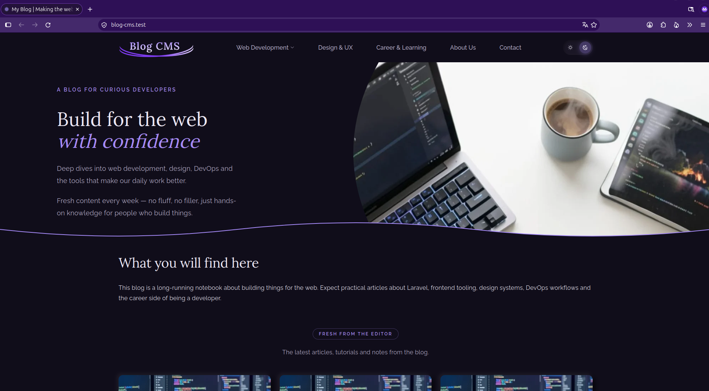
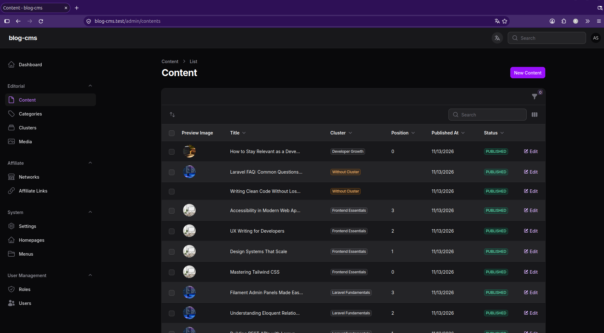
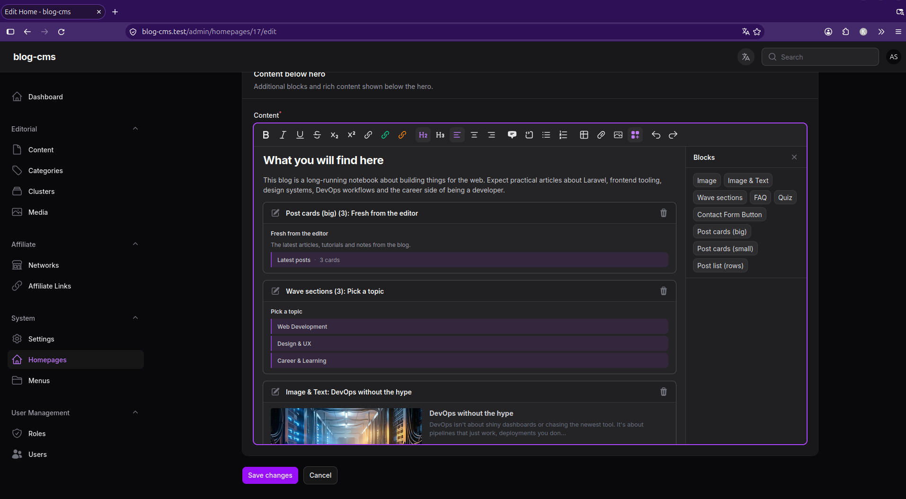
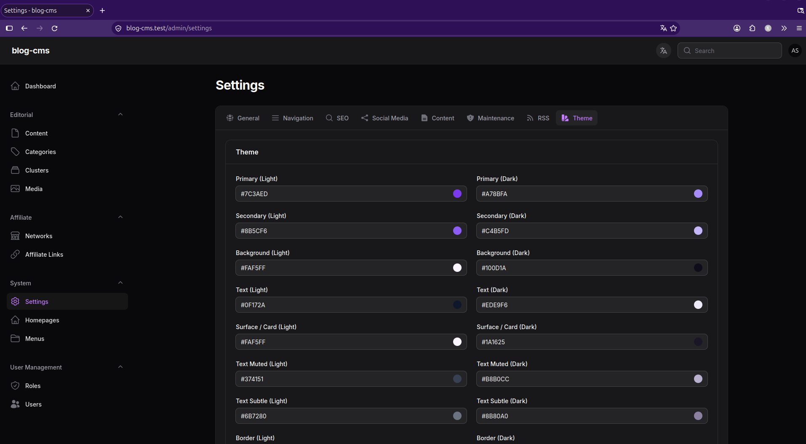

# Blog CMS

[](https://github.com/Dembalua/blog-cms/actions/workflows/ci.yml)
[](LICENSE)
[](https://github.com/Dembalua/blog-cms/commits/main)
[](https://php.net)
[](https://laravel.com)

A Laravel-based CMS for publishing editorial blogs. Built on Laravel 13 with a Filament 5 admin panel, designed around a flexible URL hierarchy, a modular rich-content editor, and an opinionated set of editorial features (clustering, affiliate tracking, theming).



## Features

- **Flexible URL hierarchy** via a polymorphic `Path` model. Any Content or Category can live at any URL; renames create automatic 301 redirects, deletes create 410s.
- **Rich content editor** with custom blocks: FAQ, Image-Text, Post-Cards (big and small), Post-List, Quiz, Sections, Contact-Form, and internal/affiliate link extensions.
- **Cluster system** for pillar and sub-article grouping, with bidirectional navigation between related clusters.
- **Affiliate link tracking** with per-article click statistics, slug-change redirects, and dead-link detection.
- **Theming** via admin UI (light and dark color palettes, logos, favicon, font settings) without touching code.
- **SEO essentials** out of the box: sitemap generation, RSS feed, IndexNow submission, per-page meta data and robots directives.
- **Maintenance mode** with IP whitelist and selectable public pages.
- **Role-based access control** via Filament Shield, plus 2FA via one-time codes.

## Screenshots

### Admin, content list


### Admin, rich editor with custom blocks


### Admin, theme settings


## Tech stack

- **Laravel 13 and Filament 5** for the admin panel. Livewire gives reactive interactions without the overhead of an SPA, and Filament's resource/form abstraction covers the editorial surface out of the box.
- **Spatie packages** (`laravel-sitemap`, `laravel-feed`, `filament-shield`) for proven solutions to common CMS concerns, instead of hand-rolled equivalents.
- **Awcodes Curator** for media library management.
- **MySQL 8** for the data store. The schema uses polymorphic relations (`Path`, `MetaData`) and pivot tables (cluster relations, affiliate click tracking) that map cleanly to a relational model.
- **PHPUnit** with a 566-test feature suite covering services, observers, forms, and the full Filament admin surface.

## Architecture highlights

### Polymorphic paths
Every Content and Category owns a `Path` record. URLs are generated from the menu hierarchy by `PathService::generateForModel()`, and resolved at request time by `PathService::resolve()`. When a slug or menu position changes, observers automatically create a `PathRedirect` (301). When a model is deleted, a 410 Gone redirect takes its place.

### PubliclyVisible contract
`Content` (status) and `Category` (active flag) both implement an `App\Contracts\PubliclyVisible` interface. `PathService::resolve()` consumes it to filter invisible content at the URL layer, so controllers never need to repeat `if (! $model->active) abort(404)` style guards.

### Rich editor with custom blocks
Built on Filament's TipTap integration. Each custom block is a self-contained class with its own form schema, `toHtml()` for public rendering, and `toPreviewHtml()` for the editor preview. The two render paths share no state, which keeps draft editing fast and the public render output deterministic.

### Cluster system
A cluster is a thematic grouping of articles with one designated pillar. Related clusters are configured in the admin and used to generate suggested-reading navigation on article pages. Pillar validation is enforced at save time, so a cluster can never end up with two pillars.

### Setting cache
Application-wide configuration (site name, menu assignments, theme colors, maintenance flags) lives in a key-value `Setting` store. Values are cached aggressively and invalidated by model observers, so settings reads are effectively free at request time.

## Installation

<details>
<summary>Local setup</summary>

### Requirements

- PHP 8.5+
- Composer
- Node.js and npm
- MySQL 8

### Steps

```bash
git clone git@github.com:Dembalua/blog-cms.git
cd blog-cms
composer install
cp .env.example .env
php artisan key:generate
php artisan curator:token
```

The `curator:token` command generates a Glide signing token and writes it to `.env` as `CURATOR_GLIDE_TOKEN`. Without it the media library will throw on image URL generation.

Create a MySQL database, edit `.env`, then:

```bash
php artisan migrate --seed
npm install
npm run build
php artisan storage:link
```

Admin login after seeding: `admin@example.com` / `Password123!`

> **Local demo credentials only.** Change the password (or create a new admin user and delete the seeded one) before deploying anywhere reachable from the internet.

Dev data (posts, categories, etc.) is only seeded when `APP_ENV=local`.

</details>

## Testing

```bash
composer test
```

566 feature tests run against an in-memory SQLite database. Coverage includes the catch-all routing (404, 410, 301, visibility), observer-enforced invariants (menu/category conflict, path redirects), the full Filament admin surface, and all custom rich-content blocks.

## License

Released under the MIT License. See [LICENSE](LICENSE).
